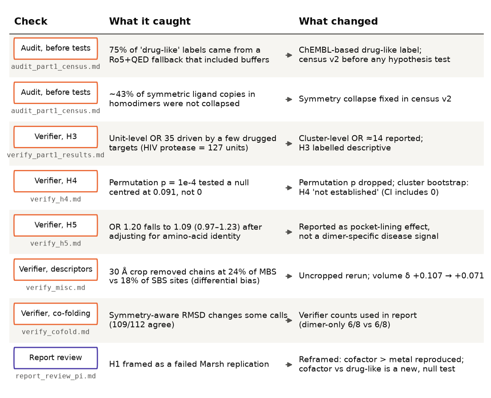

# Why this question, and why this experiment

**The biological question.** A *ligand* is a small molecule that binds a protein, for example:

- a cofactor such as NAD or FAD,
- a metal ion,
- a metabolite,
- a drug.

It binds in a *pocket*, a cavity on the protein surface. Most proteins do not work alone. A large fraction form *homodimers* (two copies of the same chain) or *heterodimers* (two different chains), and sometimes a pocket is formed by both chains together.

Abrusán and Marsh (2018) called these **multi-chain binding sites (MBS)**, in contrast to **single-chain binding sites (SBS)**. Using the 2013 BioLiP database of biologically relevant ligands, they reported three things:

- MBS carry more cofactors and fewer metals.
- MBS in homomers are evolutionarily more conserved.
- Variants in MBS are often pathogenic.

They also suggested that MBS might call for different drug-design strategies, but did not measure druggability.

Since then, two things have changed the landscape:

1. The PDB has grown to more than 250,000 entries. Quaternary-aware resources such as Q-BioLiP (Wei et al. 2024) and PLINDER (Durairaj et al. 2024) now annotate ligands on full biological assemblies.
2. AlphaFold has produced models of hundreds of thousands of predicted complexes, including the human dimer sets used here.

Pocket atlases built on AlphaFold models have so far been built from single chains (e.g. PocketVec, AlphaFill). A pocket formed between two chains is invisible to them. One recent preprint (ProtPocket, 2026) began comparing pockets in single-chain and dimer models of AlphaFold homodimers.

**The questions** we were given:

- **Part 1.** How do single- and multi-chain pockets differ in monomers, homodimers and heterodimers of the PDB, once crystallisation additives are excluded?
- **Part 2.** Using in-house tools for pocket finding, pocket comparison and docking:
  - Do pockets in *predicted* dimers match real PDB pockets?
  - How do pockets in human dimers compare with monomer pockets?
  - Are multi-chain sites more or less druggable, and do they bind different classes of ligands?
  - Can co-folding (predicting protein and ligand together) shed light on the interesting cases?

**The meta-question.** The study was also a test of *agentic science*: can a team of AI agents run an open-ended computational biology project end to end, reproducibly and honestly? A human gave the brief. One AI agent acted as principal investigator (PI). It delegated work to other AI agents ("sub-agents"), reviewed their output, and kept the research record. No human intervened in the science. The human only made a missing paper available, pointed to the correct dimer directory, extended the deadline shortly after launch, and warned about a resource limit that had crashed an earlier attempt.

This briefing describes both layers: what we learned about protein pockets, and what we learned about running research this way.

# Key terms

| Term | Meaning here |
|---|---|
| **Ligand site** | One bound small molecule together with the protein residues it touches. |
| **SBS / MBS** | Single-/multi-chain binding site: the ligand touches residues from one chain, or from at least two. |
| **Homomer / heteromer** | A complex of identical chains / of different chains. A **dimer** has two chains. |
| **Additive** | A molecule that is in the crystal because of the experiment, not the biology: glycerol, sulfate, PEG, buffers. |
| **Cofactor** | A small organic helper molecule used by enzymes (NAD, FAD, SAM, PLP, CoA, heme …). |
| **Drug-like ligand** | Here: a compound that ChEMBL records as a clinical candidate or as potently active (pChEMBL ≥ 6) on some target, and that is not a cofactor, metabolite or buffer. This includes tool compounds, not only approved drugs. |
| **On-axis site** | In a symmetric homodimer, a single ligand that straddles the two-fold symmetry axis and touches equivalent residues on both chains. **Off-axis** sites come in symmetric pairs, one per side. |
| **Interface pocket** | A predicted pocket lined by at least three residues from each chain. |
| **Dimer-only pocket** | An interface pocket that does not exist when each chain is analysed on its own. |
| **Co-folding** | Predicting the structure of protein chain(s) and a ligand together, here with AlphaFold3. |
| **RMSD** | Root-mean-square deviation: the average atomic distance between a predicted and an experimental ligand pose. ≤ 2 Å is the usual "correct pose" threshold. |
| **DCC** | Distance from a predicted pocket's centre to the ligand's centre. ≤ 4 Å counts as a hit. |
| **Odds ratio (OR)** | How much higher the odds of an outcome are in one group than in another; 1 means no difference. |
| **Cliff's δ** | A distribution-free effect size from −1 to 1; 0 means no difference. |
| **Protein family** | Here: a cluster of proteins sharing ≥ 30% sequence identity, used so that heavily studied proteins are not counted many times. |
| **pChEMBL ≥ 6** | Measured potency of 1 µM or better on some target in the ChEMBL database. |
| **Apo / holo** | A structure without / with its bound ligand. Predicted models are apo. |
| **Obligate homodimer** | A protein that only functions (and often only folds) as a two-copy complex. |
| **Sign test / McNemar test** | Paired tests on the same cases: the sign test asks how often one condition gives the better (lower) RMSD; McNemar asks whether one condition turns failures into successes more often than the reverse. |
| **NAD, FAD, SAM, PLP, CoA, ThDP** | Common enzyme cofactors: nicotinamide adenine dinucleotide, flavin adenine dinucleotide, S-adenosylmethionine, pyridoxal phosphate (vitamin B6), coenzyme A, thiamine diphosphate (vitamin B1). |
| **Pre-registration** | Writing down the hypotheses, metrics and tests before seeing any results, so they cannot be tuned afterwards. |

# How the AI team worked

**Setup.**

- **Hardware:** one cluster node with 64 CPU cores, about 500 GB of memory and four GPUs. One GPU turned out to be faulty.
- **Data:**
  - a local PDB copy;
  - the AlphaFold database, including a pre-computed "pocket atlas" for single-chain models;
  - roughly 10,600 confident AlphaFold models of human homo- and heterodimers, plus models from 12 other species;
  - pre-computed alignment files for AlphaFold3.
- **Tools:** in-house software for pocket finding (BURROW), pocket comparison (pocketcompare) and docking (adock).
- **Time budget:** 15 h, extended by the human shortly after launch to about 24 h.

**Process.** The PI agent followed a fixed sequence:

1. **Reconnaissance.** Four sub-agents in parallel inspected the data, installed and benchmarked the tools, reviewed the literature, and tested whether AlphaFold3 could run on the available GPUs.
2. **Design under critique.** The PI drafted a design. Five AI reviewers critiqued it in round one, each with a role: an external PI, prior-work expert, statistician, compute expert, and expert on AI-agent failure modes. Two more reviewed it in round two. Each reviewer had to propose concrete changes or state that none were needed. The design was then *frozen* (tagged and hashed in git) with five pre-registered hypotheses (H1–H5).
3. **Production.** Worker agents built the PDB census, ran pocket detection on all dimer models, and performed the analyses. They followed a shared compute policy, because the account could run at most 5,120 threads and an earlier session had crashed when agents launched parallel jobs simultaneously.
4. **Independent verification.** Before any result was relied on, a *different* agent re-derived it. The verifier wrote its own code from the definitions, without importing the producer's scripts.
5. **Reporting.** The PI wrote the report. An external-PI reviewer and a statistics/integrity reviewer checked it, and a final fresh agent re-checked consistency.

In total, the PI launched about 50 sub-agent tasks (counted from its own session log) and made over 110 git commits. It kept a running *research tree* (status of every branch of the investigation) and a *lessons* file of process rules learned along the way.

# Step 1: Building the experimental benchmark from the PDB

**Why build our own?** Existing resources either work on crystallographic asymmetric units, which can split or duplicate biological complexes, or do not break down multi-chain sites by ligand class. We therefore re-derived the multi-chain status of every ligand on the *biological assembly* (the complex as it exists in the cell). We took the key definitions from earlier work:

- **MBS definition.** A ligand is multi-chain if at least two protein chains each contribute at least one contacting residue. This is the rule of Abrusán and Marsh (2018).
- **Contact definition.** An atom pair is in contact if the distance is below the sum of the van der Waals radii plus 0.5 Å. A residue counts as binding if it makes at least two such contacts, and a ligand needs at least two binding residues. This is the rule of BioLiP and BioLiP2 (Zhang et al. 2024).
- **Excluding additives.** This is the hardest part. A sulfate in a crystal is usually an artefact, but sometimes it is real biology. We adopted BioLiP2's curated biological-relevance labels, plus the depositors' own "subject of investigation" flag in the PDB files. A geometric rule and the PLINDER artefact list were kept as sensitivity checks.

**Scale.**

- 261,139 PDB entries were filtered to 214,263 good-quality structures (X-ray ≤ 3.0 Å, cryo-EM ≤ 3.5 Å).
- These held 1.9 million ligand instances in their biological assemblies.
- Additive filtering alone removed about 460,000 instances.
- The final primary set has about 500,000 ligand instances.
- Redundancy was handled by grouping proteins into 30% sequence-identity clusters and counting each (cluster, ligand) pair once. This gave about 44,000 non-redundant units.

**What the audit caught.** The pipeline passed its known-answer tests (16 in the final version). Examples:

- the HIV-1 protease inhibitor, which must be multi-chain and on the symmetry axis;
- lysozyme ligands, which must be single-chain;
- glycerol, which must be excluded.

An independent audit agent then recomputed contacts for 40 random ligands directly from the raw files and found the geometry correct. It also found three labelling errors that would have invalidated the hypothesis tests:

1. Three quarters of the "drug-like" ligands came from a fallback rule based only on physicochemical properties (Lipinski rules and QED), so buffers such as MES and HEPES, cholesterol and citrate were counted as drugs.
2. Symmetric copies of the same site in homodimers were merged in only 57% of cases.
3. The fallback additive label used for recent entries behaved differently from BioLiP2.

All three were fixed before any hypothesis was tested. Drug-likeness was re-defined via ChEMBL activity data, and symmetric copies were merged by residue overlap (now 96.5%).

**Result.**

- After additive filtering, **26% of non-redundant sites (31% of non-redundant ligand-protein units)** in oligomers are multi-chain.
  - This is consistent with the 25% reported by PLINDER and the 28.8% reported by Q-BioLiP, although the definitions differ.
- Lipids and hemes are the most often multi-chain; metals are rarely so.
- Heteromer numbers are inflated by large photosynthetic complexes full of chlorophyll. Without them, the multi-chain share of heteromer ligand instances drops from 31% to 23%.
- The Abrusán–Marsh observation that cofactors are more often multi-chain than metals is reproduced: 34% vs 12% of homomer ligand instances.

# Step 2: What the PDB says about ligand classes and druggability

We pre-registered three PDB hypotheses.

**H1. Are cofactors more often multi-chain than drug-like ligands?**

- **No.** The adjusted odds ratio is 0.89 (95% CI 0.61–1.32). This was independently verified.
- This is a *new* comparison, not a failed replication: Abrusán and Marsh compared cofactors with metals, not with drugs.
- With a stricter definition (at least three contacting residues on each chain), the direction reverses: cofactors are *less* often multi-chain (OR 0.41).
- The verifier traced this reversal to the five most abundant cofactors: NAD(P), FAD, SAM, PLP and CoA. These usually sit in one chain and are touched by only one or two residues of the partner.
- **Interpretation:** the classic enzyme cofactors are typically *anchored in one chain*. The partner contributes at most a rim.

**H2. Within the same protein family, do multi-chain sites bind drug-like ligands more often?**

- **Weakly, and not robustly.** OR 1.17 (1.04–1.31).
- The effect disappears when the ten largest protein families are left out, or when drug-likeness is defined by physicochemical rules instead of ChEMBL activity.

**H3. Do ligands on the two-fold axis of homodimers differ from those off the axis?**

- **Yes, strongly.**
  - 64 protein families have drug-like ligands bound on the axis.
  - Only 8 families have cofactors there.
  - Off the axis the balance is reversed: 334 drug-like vs 576 cofactor families.
- At family level the odds ratio is about 14. It remains clearly above 1 when viral proteins or the 20 largest families are removed (OR 5.8).
- Two caveats keep this result descriptive:
  - The on-axis cofactor group is too small for the pre-registered power rule (at least 30 families per group). That reading of the rule was adopted after seeing the data and is disclosed.
  - The pattern is *between* proteins. Only 34 families have both on- and off-axis sites, too few to test it within the same protein.

**Examples of on-axis drugs:**

- HIV-1 protease inhibitors;
- transthyretin stabilisers such as tafamidis;
- AMPA-receptor potentiators that bind the dimer interface of the ligand-binding domain;
- PD-L1 inhibitors that *induce* PD-L1 dimerisation;
- PKM2 activators;
- IDH2 allosteric inhibitors;
- STING agonists.

**Interpretation (a hypothesis, not a demonstration).** Many of these compounds act by stabilising or inducing an oligomer, or by allosteric control across the interface. A two-fold axis offers a site that exists only in the complex and presents two copies of each contact. That suits a molecule designed to hold the complex together. Natural cofactors, by contrast, usually serve one catalytic centre per chain.

This fits the link between multi-chain homomer sites and allostery reported by Abrusán and Marsh (2019), and the "dual-binding" interface stabilisers described by Chen and Zacharias (2023). Drug-discovery bias may also contribute: well-studied symmetric targets attract many inhibitors.

**Druggability: no difference.** None of the in-house tools predicts druggability. We therefore added fpocket (Le Guilloux et al. 2009, with the druggability score of Schmidtke and Barril 2010) and ran it on 2,901 PDB sites sampled evenly across ligand classes.

- Multi-chain and single-chain sites were equally druggable: Cliff's δ +0.01. The fraction with druggability above 0.5 was 40% vs 39%.
- The in-house pocket score (BURROW's score at the ligand) also showed no overall difference; within protein families it was even slightly lower at multi-chain sites.
- Multi-chain pockets are only slightly larger (δ +0.07).
- **Conclusion:** sitting between chains does not make a pocket more, or less, druggable.

# Step 3: Building a pocketome of predicted human dimers

We ran the pocket finder on every human dimer model:

- 4,819 homodimers and 5,791 heterodimers;
- 87,804 pockets in total;
- the same settings as the existing single-chain atlas (checked to reproduce the atlas exactly for a test protein).

As a control, each chain was also cut out of its dimer *with identical coordinates* and analysed on its own. Any difference between the two runs is then due to the partner chain alone, not to a different model.

**What changed with the partner.** All of the following were verified by an independent agent.

- **Interface pockets are over-represented.**
  - About 31% of pockets line the interface, which is 1.9 times more than the interface's share of the protein surface would predict.
  - Part of this is intrinsic. When the partner is moved away, the same surface patches remain somewhat concave.
- **Interface pockets look different.** Compared with single-chain pockets in the same models they are:
  - larger (Cliff's δ +0.23);
  - more charged (+0.20);
  - less hydrophobic (−0.15).

  These differences reverse when the partner is removed, so they are caused by the partner.
- **Many interface pockets are "dimer-only".**
  - About 64% of interface pockets have no counterpart in the isolated chains.
  - The pocket finder is somewhat noisy between the two contexts: 17–20% of pockets *away* from the interface also lose their counterpart, mostly weak pockets.
  - After matching for pocket score, the dimer-specific excess is still about 47 percentage points.

**Which dimer-only pockets look most credible?** With filters written down before seeing which proteins passed them (high pocket score, confident structure on both chains, at least five residues per chain, not a helical groove, drug-sized), 114 pockets remained.

- The top of this list is dominated by **active sites of enzymes that work as obligate homodimers**:
  - the PLP-dependent enzymes GCAT and SGPL1;
  - the FAD-dependent acyl-CoA dehydrogenases IVD, ACADVL and GCDH;
  - the thiamine enzyme OGDHL;
  - DPYD;
  - the cGAMP-binding cleft of STING.
- These are exactly the enzyme classes that Abrusán and Marsh found enriched at multi-chain homomer sites.
- Single-chain pocket atlases miss them as whole pockets. This holds partly by construction, because absence from the single-chain atlas was one of the filters.
- These dimer-only pockets are not more druggable than ordinary pockets by fpocket.

# Step 4: Do predicted dimer pockets find real binding sites?

**The benchmark.** We took the PDB ligand sites from Step 1 on human protein pairs for which a dimer model exists: 4,013 sites, of which 1,138 are multi-chain. We kept only sites whose experimental interface matches the predicted one, and mapped residues between experimental and predicted structures through SIFTS (a residue-level PDB-to-UniProt mapping).

A site counts as *found* if one of the top-ranked predicted pockets has its centre within 4 Å of the ligand's centre. We used the "top-(n+2)" convention of the LIGYSIS benchmark (Utgés & Barton 2024): n is the number of real sites in the structure.

**The design.** The comparison is built to answer one question: does the partner chain help? (Figure 6.)

- The same model is analysed with and without its partner.
- Single-chain sites serve as a built-in control, because they should not need the partner.
- The pre-registered statistic is a **difference-in-differences**: the gain from the partner at multi-chain sites, minus the gain at single-chain sites. A statistics reviewer suggested this design. It cancels out generic differences between the two runs.

**Result.**

- In homodimers, 40% of real multi-chain sites are found in the dimer model, against 28% in the isolated chains. Single-chain sites are found about equally often in both (43% vs 47%). Random surface patches find under 1%.
- The difference-in-differences is +0.16, but its 95% interval runs from −0.006 to 0.34. **The pre-registered hypothesis is therefore not established.**
- Three disclosures:
  1. **Permutation test.** A permutation test had given p = 0.0001, but the verifier showed that its null distribution was wrong. Sites from the same family are near-duplicates, which makes the effective sample size roughly 14–19 times smaller than the raw count, so the test overstated the evidence. It was dropped.
  2. **Family-level analysis.** The result is consistent across families: 68 families improve with the partner and 32 get worse. The family-weighted estimate is +0.16 (0.075–0.234). This analysis was not pre-registered.
  3. **Post-hoc rule.** One technical rule, how to merge mirror-image pockets in homodimers, was chosen after seeing some results. An alternative rule would have made the primary test significant. We report the more conservative rule.

**Why sites are missed.** The verifier classified every miss:

- **Isolated chains:** the pocket simply does not exist or is split in two.
- **Dimer models:** the pocket is found but merged with neighbouring cavities into one oversized pocket whose centre lies away from the ligand.
- **Too-narrow tunnels:** in NAMPT, the inhibitor tunnel in the predicted (ligand-free) structure is too narrow for the inhibitors. This is a reminder that predicted structures are *apo* (ligand-free) states.

**How good is the pocket finder in general?** We calibrated BURROW on the public LIGYSIS benchmark using its own looser metric (centre within 12 Å).

- BURROW finds 58% of sites in experimental structures, close to the 60% reported for the best published method (fpocket+PRANK).
- It finds 48% in AlphaFold single-chain models of the same proteins.
- Our 4 Å criterion is much stricter, which explains the lower absolute numbers in Figure 6.

# Step 5: Co-folding — does AlphaFold3 need the partner?

Pocket finding works on empty structures. **Co-folding** instead predicts the protein *with* the ligand. We used AlphaFold3 (Abramson et al. 2024) with pre-computed alignments and without structural templates, so it could not copy a known complex.

Two published warnings shaped the design:

- AlphaFold3-like models largely *memorise* ligand poses seen in training (Škrinjar et al. 2025).
- Predicted ligands can stay in place even after the binding residues are mutated away (Masters et al. 2025).

We therefore always compared two runs, the same ligand with and without the partner chain, preferred structures released after the model's training cutoff, and reported pre- and post-cutoff cases separately. Each comparison is a small case series (6–26 cases), so it is suggestive, not conclusive.

**Results.** Ligand RMSDs were independently re-computed and agreed with the producers' success calls in 109 of 112 cases.

- **Drugs on the two-fold axis (12 cases).**
  - Correct in 21 of 36 runs with the dimer vs 8 of 36 with a single chain, over three random seeds.
  - The single chain gave a worse pose in 11 of 12 cases (sign test p ≈ 0.006).
  - The difference in correct/incorrect counts is not significant (exact McNemar p = 0.125).
  - "Needing the partner" is partly true by construction: a single chain carries only half of an on-axis site.
  - Two of the four dimer-only successes are molecules known to *induce* dimerisation (PD-L1, XIAP).
- **Cofactors at off-axis sites, and FAD in two dimer-only enzyme sites (IVD, ACADVL).**
  - Mostly correct *without* the partner: 6 of 6 off-axis cofactors.
  - AlphaFold3 builds the cofactor's half-site from one chain. This agrees with the census finding that the major cofactors are usually anchored in one chain.
  - In the dimer-only active-site set (8 cases: mostly inhibitors, plus FAD, biotin and citrate), success was 6 of 8 both with and without the partner.
  - The clear exception is STING, whose agonist site is split evenly (7 + 7 residues) between the chains. It was correct only as a dimer, at every seed.
- **Heterodimer multi-chain sites (26 cases; extended from 6 after the first results, so post hoc).**
  - The partner improved the pose in 22 of 26 cases (p = 0.0005).
  - The gain in correct poses (14 vs 8) is borderline (p = 0.07).
  - It is concentrated in complexes already in the PDB before the training cutoff, so memorisation may contribute.
- **A tempting synthesis that did not hold.** An analysis across all 56 cases suggested that the partner helps more when it contributes a larger share of the site's residues (ρ = 0.34). It did not replicate in the larger heterodimer set (ρ = 0.09).

# Two further checks: disease variants and evolution

**Disease variants (pre-registered H5).** Are pathogenic missense variants (from UniProt's curated variant list) enriched at residues lining dimer-only pockets?

- The pre-registered comparison passed: OR 1.19 (verified; 1.06–1.34) vs interface residues outside pockets.
- But the effect is not specific to dimer-only pockets. Single-chain pocket residues show the same enrichment.
- It largely disappears once the amino-acid type is taken into account (OR 1.09, not significant). Pockets are lined by Trp, His, Cys, Tyr and Arg, residues where mutations are often damaging anyway.
- **Conclusion:** there is no dimer-specific disease signal.

**Conservation across species.**

- We matched human dimers to ortholog dimers in 12 other species.
- Interface pockets were conserved slightly more often than single-chain pockets: +3 percentage points, in heterodimers only.
- This cannot be compared directly with the Abrusán–Marsh finding on homomers, because our analysis requires a confidently predicted ortholog complex, which selects conserved complexes.

# Take-away messages: the biology

1. **Multi-chain ligand sites are common, but not special in druggability.**
   - About one in four ligand sites in protein complexes is shared between chains.
   - By two independent pocket scores, these sites are as druggable as ordinary pockets.
   - In real structures they are only slightly larger, and not more polar (Figure 5).
   - The polar, charged character of *predicted* interface pockets may be a general property of protein–protein interfaces rather than of the subset that binds small molecules. The predicted (ligand-free) and experimental (ligand-bound) sets also differ in other ways, so this is an inference, not a test.
2. **The clearest difference is symmetry.**
   - Ligands bound on the two-fold axis of homodimers are overwhelmingly drug-like.
   - Many are known oligomer stabilisers, inducers or allosteric modulators.
   - Cofactors rarely sit there.
   - This suggests on-axis pockets in predicted homodimers as a place to look for oligomer-stabilising compounds. That hypothesis has not been tested here.
3. **The classic cofactors are single-chain-anchored.**
   - NAD, FAD, SAM, PLP and CoA at "multi-chain" sites are usually held by one chain and touched at the rim by the partner.
   - Co-folding reproduces this: AlphaFold3 places them without the partner.
   - This helps explain why a broad "cofactor vs drug" comparison comes out null.
4. **Predicted dimers help find shared sites, modestly.**
   - Pockets in dimer models recover real multi-chain sites more often than isolated chains do (68 families better, 32 worse, 106 unchanged; exploratory), but not significantly at the pre-registered level.
   - Obligate-dimer enzyme active sites appear only in the dimer models and are absent as whole pockets from single-chain atlases.
5. **Co-folding is more accurate with the partner for symmetric drug sites, much less so for cofactors.** The evidence comes from small case series, success counts are not significantly different, and memorisation may contribute.

# Take-away messages: agentic science

**What worked.**

- **Independent verification was the most valuable design choice.** Each verifier rebuilt its result from the written definitions with its own code. Verifiers found:
  - the buffer-contaminated drug-like label;
  - unmerged symmetric copies;
  - an invalid permutation test;
  - a structure-cropping shortcut that inflated one effect (Figure 8);
  - and they reframed two hypotheses (H3 as descriptive, H5 as composition-driven).

  None had been caught by the producing agents.
- **Pre-registration with a frozen design** kept the hypotheses and metrics fixed. Every later change was logged as a deviation.
- **Adversarial design review** by role-specialised AI reviewers changed the design substantially before any data were analysed. Examples:
  - the statistician removed two biased baselines;
  - the external PI added the symmetry and disease-variant angles;
  - the prior-work reviewer found a relevant preprint (ProtPocket).
- **Report review** by an external-PI agent caught a framing error. We had called H1 a "failed replication" of Abrusán and Marsh, although they had never made that comparison.

**What went wrong or wasted effort.** The lessons file records these as rules.

- **Open-ended agent tasks overran.** One tool-installation task took 3 hours instead of 1. Fix: give every agent a wall-clock budget and a stop condition.
- **Infrastructure failures cost hours.**
  - A faulty GPU silently produced invalid AlphaFold3 output (about 3 hours lost).
  - The network filesystem stalled program start-up overnight, leaving runs incomplete until the environment was copied to local disk.
- **The account's thread limit, not CPU count, was the binding constraint.** An earlier attempt crashed on it. A shared compute policy (one thread per worker, a ledger of running jobs) prevented a repeat.
- **Post-hoc choices still crept in**, even with pre-registration:
  - the symmetric-pocket merge rule in Step 4;
  - the strict reading of the power rule in H3;
  - choosing deep-dive topics partly for interpretability.

  All are disclosed, but they show that pre-registration reduces analyst freedom without removing it.
- **Late exploratory analyses created verification debt.** Analyses added in the last third of the project needed a last-minute verification pass. A better rule: close exploratory scope at about two-thirds of the time budget.

**Overall.** The agentic team produced a self-critical study, designed to be reproducible (not yet independently rerun), at a sizeable scale: the whole PDB, all human dimer models and about 250 co-folding runs in roughly 17.5 hours. Its quality depended less on any single agent being right than on the structure around the agents:

- independent re-derivation;
- frozen designs;
- explicit logging of deviations.

The scientific outcome is honest but modest. The strongest finding (drugs on symmetry axes) is descriptive, the main predicted-structure test is inconclusive, and several hypotheses came out null.

# Limitations

- **Labels.** Biological relevance of PDB ligands (BioLiP2) and drug-likeness (ChEMBL) are imperfect. ChEMBL drug-likeness includes tool compounds and misses unregistered inhibitors.
- **Selection.** The dimer models are pre-selected as confident predictions, so all predicted-structure results apply to confidently predicted interfaces only.
- **Memorisation.** Most benchmark complexes were in the PDB before AlphaFold's training cutoff.
- **Apo structures.** Predicted structures have no ligand, so binding-induced pocket changes are missed.
- **Redundancy.** Inhibitor series inflate counts for heavily studied proteins (for example HIV protease), so we report family-level estimates where possible.
- **Small co-folding sets.** Co-folding results are small case series without DockQ-type complex-quality checks.
- **Other species.** These were used only for the conservation analysis.

# Credits: ideas taken from the literature

The working pipeline combines ideas from several sources.

**From the literature:**

- **Single- vs multi-chain framework:** the definitions and the question itself come from Abrusán and Marsh (2018, 2019).
- **Contacts and additives:** the contact rule and the biological-relevance labels come from BioLiP2 (Zhang et al. 2024). The idea of re-deriving everything on biological assemblies follows Q-BioLiP (Wei et al. 2024) and PLINDER (Durairaj et al. 2024).
- **Recovery metric:** the top-(n+2) ranking convention and the distance-based hit criterion come from the LIGYSIS benchmark (Utgés & Barton 2024).
- **Druggability score:** fpocket (Le Guilloux et al. 2009) with the druggability model of Schmidtke and Barril (2010).
- **Co-folding controls:** the release-date split and the partner-present/absent comparison respond to Škrinjar et al. (2025, Runs N' Poses) and Masters et al. (2025).
- **Interpretation of on-axis drugs:** draws on Chen and Zacharias (2023) on interface stabilisers.
- **Data:**
  - AlphaFold database dimer models (Han et al. 2026) and AlphaFold-Multimer/AlphaFold3 (Evans et al. 2021; Abramson et al. 2024);
  - UniProt humsavar;
  - ChEMBL;
  - SIFTS.

**Contributed in this project:**

- the isolated-chain control with identical coordinates (in the PI's first design draft; made the primary control at the AI statistics reviewer's suggestion);
- the difference-in-differences recovery design (proposed by the AI statistics/PI reviewers in design round two);
- the on-/off-axis classification;
- the side-by-side comparison of predicted and experimental interface pockets.

**In-house tools:** pocket finding (BURROW), pocket comparison (pocketcompare) and docking (adock) were provided by parallel teams. Docking was not used in the final analyses.

# Reproducibility

The accompanying repository is designed so that the study can be rerun; this has not yet been tested independently. It contains:

- code, the frozen design, the research tree, all reviews and verification reports;
- summary result tables;
- dataset versions and checksums (with licences);
- environment lock files;
- the seeds used.

Large data, model weights and restricted datasets are not included. They are fetched or regenerated by scripts.

# References

- Abramson J. et al. (2024) Accurate structure prediction of biomolecular interactions with AlphaFold 3. *Nature*. doi:10.1038/s41586-024-07487-w
- Abrusán G., Marsh J.A. (2018) Ligand binding site structure influences the evolution of protein complex function and topology. *Cell Reports* 22:3265–3276. doi:10.1016/j.celrep.2018.02.085
- Abrusán G., Marsh J.A. (2019) Ligand-binding-site structure shapes allosteric signal transduction and the evolution of allostery in protein complexes. *Mol Biol Evol* 36:1711–1727. doi:10.1093/molbev/msz093
- Chen S., Zacharias M. (2023) What makes a good protein–protein interaction stabilizer: analysis and application of the dual-binding mechanism. *ACS Cent Sci* 9:969–979. doi:10.1021/acscentsci.3c00003
- Durairaj J. et al. (2024) PLINDER: the protein–ligand interactions dataset and evaluation resource. bioRxiv. doi:10.1101/2024.07.17.603955
- Evans R. et al. (2021) Protein complex prediction with AlphaFold-Multimer. bioRxiv. doi:10.1101/2021.10.04.463034
- Le Guilloux V., Schmidtke P., Tuffery P. (2009) Fpocket: an open source platform for ligand pocket detection. *BMC Bioinformatics* 10:168. doi:10.1186/1471-2105-10-168
- Han et al. (2026) AlphaFold Database expands to proteome-scale quaternary structures. bioRxiv. doi:10.64898/2026.03.27.714458
- Masters M.R., Mahmoud A.H., Lill M.A. (2025) Investigating whether deep learning models for co-folding learn the physics of protein–ligand interactions. *Nat Commun*. doi:10.1038/s41467-025-63947-5
- Schmidtke P., Barril X. (2010) Understanding and predicting druggability. *J Med Chem*. doi:10.1021/jm100574m
- Škrinjar P., Eberhardt J., Durairaj J., Schwede T. (2025) Have protein–ligand co-folding methods moved beyond memorisation? (Runs N' Poses). bioRxiv. doi:10.1101/2025.02.03.636309
- Utgés J.S., Barton G.J. (2024) Comparative evaluation of methods for the prediction of protein–ligand binding sites (LIGYSIS). *J Cheminform*. doi:10.1186/s13321-024-00923-z
- Wei H., Wang W., Peng Z., Yang J. (2024) Q-BioLiP: a comprehensive resource for quaternary structure-based protein–ligand interactions. *Genomics Proteomics Bioinformatics* 22:qzae001. doi:10.1093/gpbjnl/qzae001
- Zhang C., Zhang X., Freddolino P.L., Zhang Y. (2024) BioLiP2: an updated structure database for biologically relevant ligand–protein interactions. *Nucleic Acids Res* 52:D404. doi:10.1093/nar/gkad630

*Full bibliographic details and DOIs (checked against Crossref) are in the project's literature review, project_record/LITERATURE.md.*
