# Single-chain vs multi-chain ligand pockets in experimental and predicted protein dimers

**Status: REPORT v3** (PI, 2026-10-30 ~04:00). Revised after:
- an external PI review: reviews/report_review_pi.md
- a statistics/integrity review: reviews/report_review_stats.md

**v3 additions (2026-10-30 ~04:00):** uncropped PDB descriptors; fpocket druggability; LIGYSIS calibration; co-folding seeds 1–2; heterodimer co-folding extension. These additions were independently verified (reviews/verify_v3.md), and the completed seed and heterodimer counts were re-derived in a final review. The 56-case co-folding synthesis comes from a single producer.

**Tags**
- **[VERIFIED]**: an independent agent re-derived the number (reviews/verify_*.md).
- **[UNVERIFIED]**: one producer only.
- **[PRE-REG]**: primary test of the frozen DESIGN.md v3 (git tag `design-v3-frozen`).
- **[EXPLORATORY]**: everything else.

Where producer and verifier differ, the verifier's number is quoted.

---

## Summary

### Answers at a glance

| Question (PROMPT.md) | Short answer | Strength |
|---|---|---|
| Part 1: single- vs multi-chain sites in the PDB | ~26–31% of ligand sites in oligomers span >1 chain after removing additives. Lipids and hemes are the most multi-chain-prone ligands; metals the least. Marsh's cofactor > metal pattern is reproduced. | VERIFIED |
| Do predicted dimer pockets match PDB pockets? | ~40% of homodimer multi-chain sites are hit by a predicted pocket (DCC ≤4 Å), vs ~28% using isolated chains. The pre-registered dimer advantage is not established (DiD +0.16, CI includes 0), but 68 vs 32 families favour the dimer. | PRE-REG, VERIFIED |
| Dimer vs monomer pockets | Interface pockets are over-represented ~1.9× relative to the interface surface (part of this is intrinsic surface shape). Because of the partner, they are larger, more charged and less hydrophobic. Real ligand-bound multi-chain sites are only larger. | EXPLORATORY, VERIFIED / UNVERIFIED |
| Druggability, ligand classes | Multi-chain sites are neither more nor less druggable: fpocket druggability δ +0.01 and burrow_score δ −0.01. Drug-like occupancy is at most weakly higher (OR 1.17, fragile). The new cofactor-vs-drug-like contrast is null. Drug-like ligands dominate sites on the homomer twofold axis. | PRE-REG, VERIFIED; fpocket VERIFIED |
| Other: variants, evolution, co-folding | Disease variants are enriched in pocket linings but not specifically in dimer-only pockets. Interface pockets are slightly more conserved, in heterodimers only. In AF3 co-folding the partner improves pose accuracy for on-axis drugs and heterodimer sites (RMSD). The partner benefit rose with its share of the site in one 56-case analysis (ρ 0.34), but this did not replicate in 26 heterodimer pairs (ρ 0.09). | mixed; see sections |

### In brief

We compared single-chain ligand binding sites (SBS) with multi-chain sites (MBS):
- in a 2026 PDB snapshot (214k entries; "oligomers" here means assemblies of ≤60 chains);
- in 10,610 confident AFDB human dimer models, plus 12 other species.

Methods in one line each:
- **Pockets:** the in-house BURROW/pocketcompare tools, run with the AFDB monomer pocket atlas settings.
- **Co-folding:** AlphaFold3.
- **Hypotheses:** five were pre-registered, and each headline number was re-derived by an agent that did not produce it.

**1. The Marsh pattern holds; the drug-like contrast is new and null.** Abrusán & Marsh (2018) found more cofactors and fewer metals at MBS than at SBS, and we reproduce this (homomer instances: cofactors 33.8% MBS vs metals 11.8%). The new pre-registered contrast, cofactor vs drug-like, is null: OR 0.89 (0.61–1.32) [VERIFIED]. Under a strict MBS definition, the abundant cofactors (NAD(P), FAD, SAM, PLP, CoA) turn out to be anchored in one chain.

**2. Symmetry axis.** In homomers, sites on the twofold axis are dominated by drug-like ligands. On-axis vs off-axis drug-like/cofactor composition gives a cluster-level OR ≈ 14 (64 drug-like vs 8 cofactor on-axis clusters) [VERIFIED; descriptive].

**3. Predicted dimers recover real multi-chain sites.** They do better than isolated chains in most protein families, but the pre-registered test is not significant [VERIFIED]. The best dimer-only pockets include canonical active sites of homodimeric enzymes (PLP, FAD, ThDP enzymes; STING1) [EXPLORATORY].

**4. Co-folding (case series).** Given only one chain, AF3 places drugs that sit on the twofold axis less accurately: RMSD worse in 11/12 cases, sign test p ≈ 0.006. The 2 Å success counts (7/12 vs 3/12) are not significant (McNemar p = 0.125). Pooled over three seeds: 21/36 vs 8/36. Across 56 cases, the RMSD benefit of including the partner chain rose with the partner's share of the site (ρ 0.34), but this did not replicate in 26 heterodimer pairs (ρ 0.09) [EXPLORATORY].

---

## 1. Background and questions

### What was known (LITERATURE.md has the DOIs)

**Abrusán & Marsh 2018** (Cell Rep, doi:10.1016/j.celrep.2018.02.085) defined SBS and MBS and used 2013-era BioLiP (asymmetric-unit based). They reported:
- more cofactors and fewer metals at MBS;
- more conserved sites in MBS homomers;
- higher pathogenic-variant burden at MBS (about 30% at small-molecule MBS heteromer sites);
- the hypothesis that MBS homomers suit multitarget drugs.

They did not measure druggability. Abrusán & Marsh 2019 (MBE) linked MBS homomers to allostery.

**Multi-chain share in quaternary-aware resources:**
- Q-BioLiP (Wei et al. 2024): 28.8%.
- PLINDER (Durairaj et al. 2024): 25%.

**Pocket atlases on AF models** are monomer-based (PocketVec, HOTPocket, AlphaFill, …). Related work:
- ProtPocket (GitHub 2026, not peer-reviewed) compares monomer and dimer pockets on AFDB homodimers.
- The AFDB complex release (Han et al. 2026) does not report pocket analyses.
- LIGYSIS (Utgés & Barton 2024) benchmarks pocket prediction on experimental monomer/homomer sites (fpocket+PRANK top-N+2 recall 60.4%).

**Co-folding caveats:**
- Runs N' Poses (Škrinjar et al. 2025): AF3-class models largely memorise poses.
- Masters et al. 2025: predicted ligands stay in place even after the site is mutated away.

### Pre-registered hypotheses (DESIGN.md §1; BH correction within each family)

**Family A (PDB):**
- H1: cofactors are more often MBS than drug-like ligands are.
- H2: drug-like occupancy differs between MBS and SBS within a cluster (secondary: burrow_score at the ligand).
- H3: on- vs off-axis homomer MBS sites differ in drug-like vs cofactor composition.

**Family B (predicted dimers):**
- H4: dimer models recover PDB MBS sites better than isolated chains (DiD vs SBS).
- H5: P/LP variants are enriched at dimer-only pocket residues vs interface non-pocket residues.

**Multiplicity and review.**
- 5 primary tests plus 1 pre-registered secondary.
- The result documents contain on the order of 250–300 further exploratory and sensitivity estimates. These are not multiplicity-corrected and should be read as hypothesis-generating.
- The design went through two review rounds with seven reviewer agents (reviews/r1_*, r2_*).

### Benchmarks and datasets

| Resource | Use here | Notes |
|---|---|---|
| PDB (local snapshot 2026-10-09) | Primary experimental data | Own census, own definitions |
| BioLiP2 | Additive/relevance labels | Primary label; covers entries up to its 2025-07 snapshot |
| Q-BioLiP, PLINDER | Published MBS fractions as plausibility references | PLINDER annotation table not downloadable (HTTPS 403), so the planned cross-check was dropped as declared |
| LIGYSIS | BURROW calibration (docs/LIGYSIS_CALIBRATION.md) | At the LIGYSIS metric (top-N+2, DCC ≤12 Å), BURROW recovers 57.6% on 192 experimental chains (paired, 467 sites) vs 48.4% on AFDB atlas models (paired); published fpocket+PRANK 60.4% |
| Runs N' Poses / PoseBusters | Not used | We stratified our own co-folding cases by release date; PoseBusters checks not run |
| AFDB dimers (13 species), AFDB monomer pocket atlas | Primary predicted data | Pre-filtered confident interfaces |
| humsavar, AlphaMissense, ChEMBL 37, SIFTS | Annotations | DATA.md |

---

## 2. Methods (brief; details in docs/)

| Component | What | Details |
|---|---|---|
| PDB census | 261,139 mmCIF → 214,263 entries: X-ray ≤3.0 Å, EM ≤3.5 Å, assembly 1 with ≤60 chains | docs/PART1_PIPELINE.md |
| Contacts / MBS | BioLiP rule (vdW + 0.5 Å); ≥2 atom contacts per residue; ≥2 binding residues per ligand. MBS = ≥2 protein chains (≥30 aa) each contribute ≥1 binding residue. Strict MBS = ≥3 residues on each of ≥2 chains | DESIGN §0 |
| Additives | BioLiP2 relevance OR wwPDB "SUBJECT OF INVESTIGATION". Primary set = BioLiP2-covered entries (logged deviation) | PART1_PIPELINE |
| Drug-like | ChEMBL 37 compound with max_phase ≥1 or pChEMBL ≥6 (so tool compounds count), excluding cofactors/metabolites/buffers; 12,276 CCDs | PART1_RESULTS |
| Symmetry | Ligand copies deduplicated at 2 Å; symmetric sites collapsed. On-axis = one ligand contacting equivalent residues on both chains (Jaccard ≥0.5); geometric check ≤3 Å from the C2 axis | PART1_PIPELINE |
| Predicted pockets | BURROW + pocketcompare 1.0.0 with the atlas settings, on dimers and on isolated chains with identical coordinates. Interface pocket = ≥3 lining residues on each chain; dimer-only = overlap <0.5 with every isolated-chain pocket | docs/TOOLS.md |
| H4 | DCC ≤4 Å within the top-(n+2) pockets; per-residue SIFTS mapping; interface-correspondence filter | docs/H4_RESULTS.md |
| H5 | humsavar 2026_03 P/LP (ClinVar-derived; declared implementation); residue GLMM | docs/H5_RESULTS.md |
| Co-folding | AF3 on Turing GPUs 1–3 (GPU 0 faulty), no templates, cached MSAs; success = ligand RMSD ≤2 Å | docs/COFOLD_*.md |
| Statistics | Cluster bootstrap (1,000 resamples); seeds [0, 1, 2], seed 0 primary; power gate ≥30 clusters | DESIGN §5 |

**Not done:**
- No druggability predictor is provided by the in-house tools. fpocket was added afterwards on a stratified subsample (§4.3); P2Rank was not run.
- No kNN ligand-class transfer.
- No PLINDER cross-check.

---

## 3. Part 1: PDB census

### 3.1 Census and additives

**Ligand cascade:**
- 1,932,129 ligand instances in assembly 1.
- The additive step removes 463,842.
- 498,712 primary instances remain: 102,247 in monomers (all SBS by definition), 260,607 in homomers, 135,858 in heteromers.
- The "subject of investigation" arm rescues 25,163 ligands.

**Audit before analysis.** The census v1 audit (reviews/audit_part1_census.md):
- recomputed contacts for 40/40 instances from raw mmCIF;
- reproduced the headline fractions;
- found three labelling errors, all fixed in v2 before any hypothesis test.

**MBS fraction by ligand instance, census v2 primary set** [VERIFIED, reviews/verify_v3.md]:

| Assembly | All | Cofactor | Metal | Small molecule |
|---|---|---|---|---|
| Homomer | 24.6% | 33.8% | 11.8% | 31.3% |
| Heteromer | 30.8% (23.2% without photosynthetic complexes) | 35.5% | 9.0% | 43.3% |

**Non-redundant units** (30% cluster × ligand) [VERIFIED, reviews/verify_v3.md; ±0.3 pp depending on how the 423 collapsed sites whose copies span two clusters are assigned, a rule the docs do not define]:
- MBS fraction: 26.3% (23.9–28.6) of sites, 30.6% (28.1–33.1) of units.
- By assembly: homomer 29.2%, heteromer 34.9%.
- Most MBS-prone classes: lipids 42.6% / 70.3% and heme 39.0% / 64.7% (homomer / heteromer).
- PLINDER's 25% lies within our site-level CI. Q-BioLiP's 28.8% lies just above it. The definitions differ.
- The additive filter removes about a quarter of ligand instances but barely moves the MBS fraction (26.7 → 26.3% of sites).
- Photosynthetic complexes strongly inflate heteromer MBS.

**Marsh comparison.** Their cofactor > metal pattern at MBS is reproduced (table above).

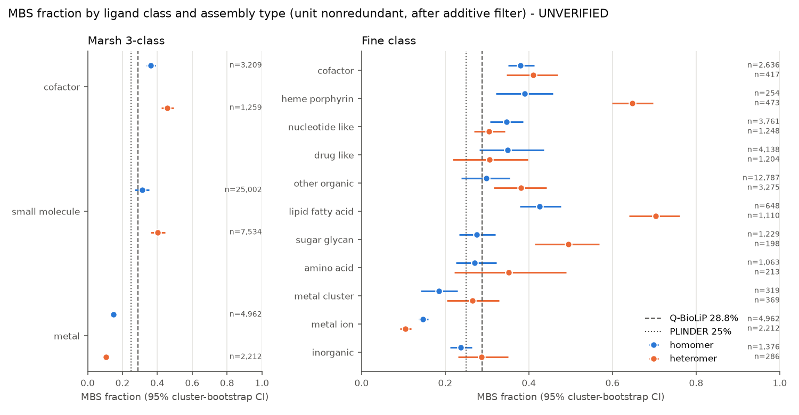

### 3.2 Pre-registered H1–H3 (docs/PART1_RESULTS.md; reviews/verify_part1_results.md)

| Test | Estimate (95% CI) | p (BH, family A) | Status |
|---|---|---|---|
| **H1** cofactor vs drug-like, adjusted OR of MBS | **0.89 (0.61–1.32)** | 0.57 | [PRE-REG][VERIFIED] null |
| **H2** drug-like occupancy, MBS vs SBS within cluster30 | **1.17 (1.04–1.31)** | 0.013 (0.017 if H3 is excluded from the family) | [PRE-REG][VERIFIED] weak, fragile |
| **H3** drug-like vs cofactor, on- vs off-axis homomer MBS | unit OR 35.4 (12.6–99.4); **cluster-level ≈14** | 3.5e-11 | [PRE-REG][VERIFIED] **descriptive** |

**H3 power gate.** The on-axis cofactor cell has only 8 clusters. Read per stratum, the pre-registered power gate passes (that is what PART1_RESULTS reports). Read per cell, it fails. The per-cell reading was adopted after the results were seen (logged), so H3 is reported descriptively.

**H1: a new contrast, and null.**
- Marsh never compared cofactors with drug-like ligands.
- Strict MBS reverses the OR to 0.41 (0.22–0.76) [VERIFIED]. The reversal is driven by the major cofactors (NAD(P)(H), FAD, SAM/SAH, PLP, CoA). They are 38% MBS under the primary rule but only 16% under the strict rule.
- Dropping the top-10 cofactors gives 0.75 (ns) under the strict rule and 1.86 (1.26–2.75) under the primary rule.
- **Interpretation:** abundant cofactors bind in one chain, with peripheral partner contacts. Minor cofactors lean towards genuine MBS.

**H2 robustness.**
- Not robust to leaving out the top-10 clusters: 1.08 (0.95–1.22).
- Not robust to the Ro5+QED definition: 1.05.
- Stronger under strict MBS: 1.52.

**H3 robustness** [VERIFIED].
- Without viral proteins: 23.6.
- Without the top-10 clusters: 9.0 (verifier); 18.8 (producer).
- Without the top-20 clusters: 5.8 (2.6–12.9).
- Base rates among off-axis sites: 334 drug-like vs 576 cofactor clusters.
- Only 34 clusters have both on- and off-axis sites (sign test p = 0.38), so this is a **between-protein** pattern.

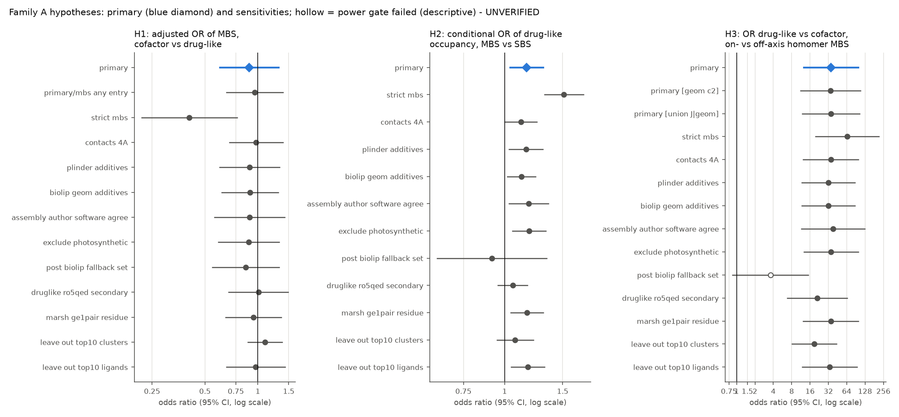

### 3.3 Pocket descriptors at real PDB sites (docs/PDB_SITE_DESCRIPTORS.md) [uncropped deltas VERIFIED, reviews/verify_v3.md]

11,983 sites (organic, oligomer units, stratified MBS/SBS × class) from 4,256 clusters. The BURROW pocket was located at each ligand on the whole assembly 1 with the ligand removed (uncropped; primary).

An earlier 30 Å-cropped run is kept as a sensitivity analysis. The independent check showed that chains were cropped at 24% of MBS and 18% of SBS sites; at those sites burrow_score changed and inflated the MBS size effect (+0.107 cropped → +0.071 uncropped).

- **[PRE-REG secondary] burrow_score, MBS vs SBS:** δ −0.009 [−0.071, +0.056], no difference. Adjusted for ligand size and class, p = 0.86. Within clusters it is slightly lower for MBS (β −0.03, p = 0.014).
- **[EXPLORATORY] Size:** MBS pockets are modestly larger. Merged volume δ +0.071 [+0.010, +0.132]; adjusted p = 0.03; within-cluster p = 4e-4. That is about a third of the AF-dimer effect.
- **[EXPLORATORY] Lining chemistry:** no difference. Charged δ −0.009 [−0.068, +0.047]; hydrophobic +0.027 [−0.030, +0.078].
  - Both the 4 Å contact set and the BioLiP-rule contacts give the same picture.
  - In predicted dimers the same contrasts are +0.20 (charged) and −0.15 (hydrophobic).

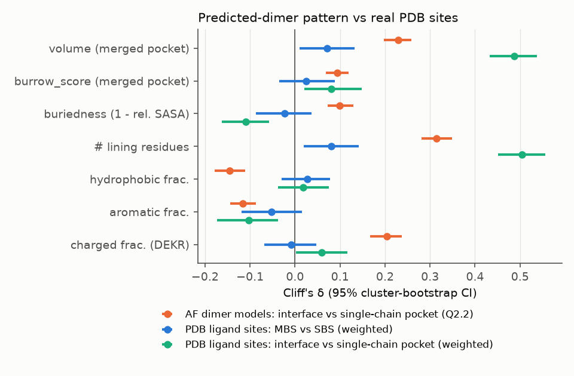

---

## 4. Part 2: predicted dimers

### 4.1 Do predicted dimer pockets match real PDB pockets? (H4; docs/H4_RESULTS.md; reviews/verify_h4.md)

**Benchmark.** 4,013 PDB organic ligand sites (1,138 MBS) on human pairs that have a dimer model, after the interface-correspondence filter.
- The filter removes 24% of homodimer MBS units but only 6.5% of SBS units.
- **Unfiltered result (required by DESIGN):** n = 4,566; MBS hit rate 0.305 (dimer) vs 0.205 (isolated); DiD 0.136 (−0.006 to 0.292).

**Hit rates** (DCC ≤4 Å, top-(n+2)) [VERIFIED; DCC recomputed from raw coordinates agrees for 3,980/4,013 sites]:

| | n | Dimer | Isolated chains | Random patches |
|---|---|---|---|---|
| Homo MBS | 1,019 | **0.401** | 0.278 | 0.005 |
| Homo SBS | 2,260 | 0.432 | 0.469 | 0.005 |
| Hetero MBS | 119 | **0.227** | 0.134 | 0.000 |
| Hetero SBS | 615 | 0.283 | 0.350 | 0.007 |

**[PRE-REG] H4 primary** [VERIFIED].
- MBS gain +0.120; SBS gain −0.043.
- **DiD +0.164; cluster-bootstrap CI −0.006 to 0.338** (kind-stratified −0.005 to 0.331); p ≈ 0.07 (BH family B ≈ 0.07).
- **Not established.**
- **Bootstrap vs permutation.** The design allowed either; we report the cluster bootstrap. The within-cluster permutation gives p = 1e-4, but its null is not centred at 0 and it ignores within-family redundancy (design effect 14–19).
- **Dependence on the collapse rule:**
  - The symmetric-pocket collapse rule was not pre-specified and was chosen after seeing hits.
  - The chosen swapped-Jaccard rule gives the non-significant result above.
  - The overlap-coefficient rule used by the other analyses would give 0.175 (0.014–0.326), which is significant.
  - The verdict therefore depends on a post-hoc choice. We report the more conservative one.

**[EXPLORATORY] family level** [VERIFIED].
- Family-weighted DiD 0.158 (0.075–0.234).
- Raw MBS gain: 68 families improve, 32 worsen, 106 ties. For comparison, the SBS split is 95 vs 107.
- Post-cutoff pairs: DiD 0.194 (0.030–0.349) [UNVERIFIED].

**Residue level.**
- MBS recall, homodimers: dimer 0.67, isolated 0.40, AFDB monomer atlas 0.40.
- Mean F1: 0.371 / 0.311 / 0.296.
- Recall favours the dimer's larger merged pockets.

**Failure modes** (verifier heuristics):
- Dimer misses: mostly oversized merged pockets whose centre is displaced (245/706).
- Isolated-chain misses: no pocket at the site (355/839) or the site is split across pockets (114/839).
- NAMPT: the apo tunnel in the model is too narrow for its inhibitors.

**Comparability.** Our H4 metric (DCC ≤4 Å) is much stricter than the LIGYSIS metric (DCC ≤12 Å). Calibration at the LIGYSIS metric [EXPLORATORY, VERIFIED (reviews/verify_v3.md); residue-centroid proxy for site centres]:
- BURROW on experimental chains: 57.6% top-N+2 recall, close to the published fpocket+PRANK 60.4%.
- On AFDB monomer atlas pockets of the same sites: 48.4%.
- Full atlas: 49.3% [47.9–50.6].

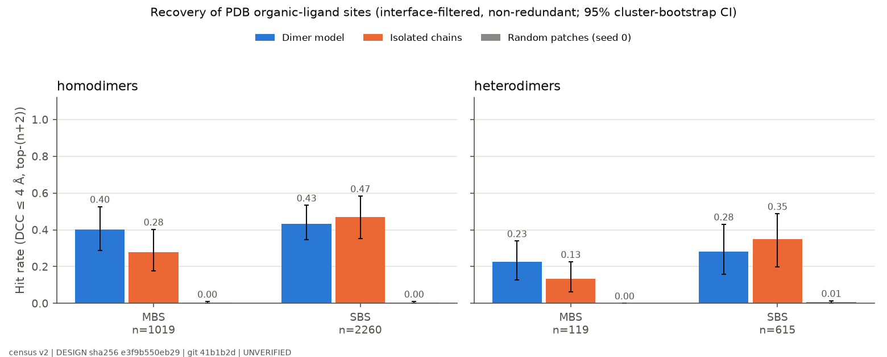
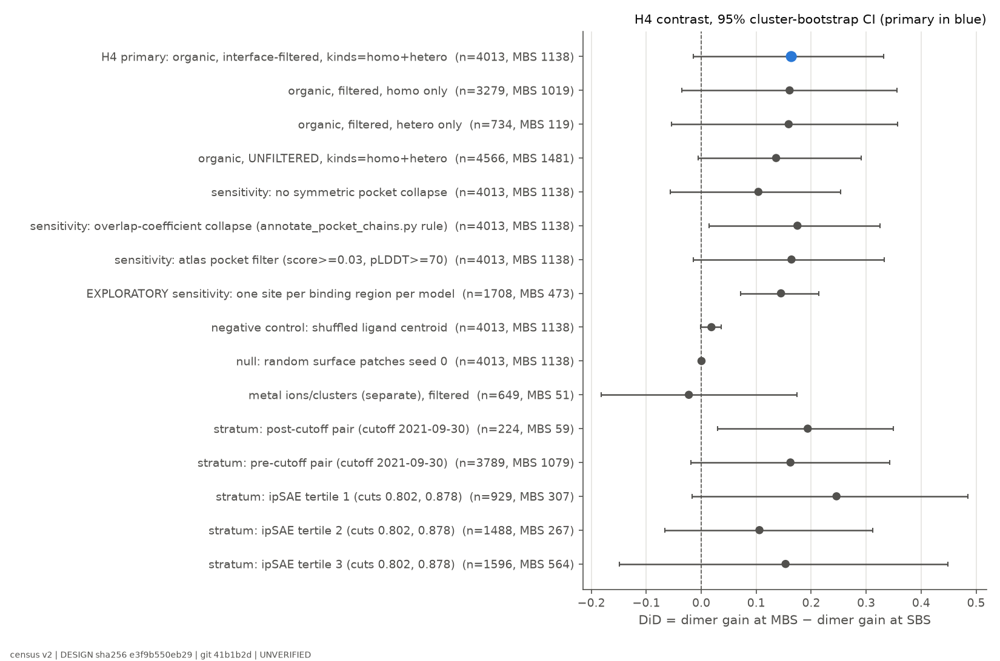

### 4.2 Human dimer pockets vs monomer pockets (docs/Q22_RESULTS.md; reviews/verify_q22.md) [EXPLORATORY]

This compares interface and single-chain pockets **within the same dimer models**, and dimer pockets with isolated-chain and monomer-atlas pockets of the same proteins. It does not compare against monomeric proteins.

**Properties** [VERIFIED].
- Interface pockets vs single-chain pockets (17,882 vs 30,231): larger (δ +0.23), more charged (+0.20), less hydrophobic (−0.15).
- These shifts are **caused by the partner**: they reverse when the partner is separated.

**Enrichment** [VERIFIED].
- Interface pockets are 1.88× [1.78–1.99] over-represented relative to the interface share of the surface.
- About 1.4× of the residue-level excess remains without the partner (intrinsic concavity of those surface patches). The partner-attributable part is ~1.75× (residue level; not multiplicative with the 1.88× pocket-level figure).

**Dimer-only pockets.**
- 63.5% of interface pockets have no counterpart in the isolated chains [VERIFIED].
- BURROW context noise is 17–20%, so the score-matched excess over that noise is +47 percentage points.

**Novelty vs the monomer atlas.** Negligible (Δ max cosine −0.01). pocketcompare is weak on PPI pockets [UNVERIFIED].

**Curated dimer-only list** [EXPLORATORY; filters VERIFIED on 5/5 rows] (results/part2/q23a_curated.tsv). Filters were declared before inspection.
- 114 pockets / 137 proteins.
- Top hits are active-site clefts of homodimeric enzymes:
  - PLP enzymes GCAT and SGPL1;
  - FAD acyl-CoA dehydrogenases IVD, ACADVL and GCDH (these are tetramers modelled here as dimers);
  - ThDP enzyme OGDHL;
  - DPYD;
  - STING1's cGAMP cleft.
- Absence from the monomer atlas is one of the filters, so "missed by monomer atlases" holds by construction for this list.
- The informative point is which pockets pass: dimer-spanning enzyme active sites. Their GO classes overlap the MBS-homomer enrichments reported by Abrusán & Marsh 2018 (acyl-CoA dehydrogenase, transaminase, ThDP binding).

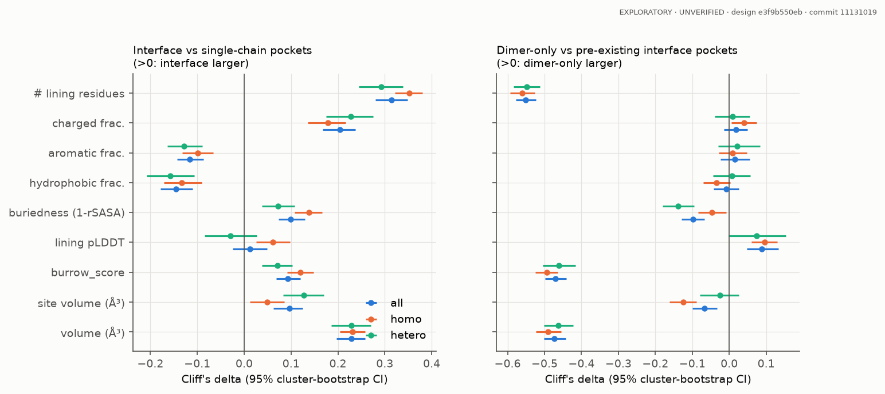

### 4.3 Druggability and ligand classes

**fpocket druggability** (fpocket 4.2.3; docs/FPOCKET_DRUGGABILITY.md) [EXPLORATORY, VERIFIED including 10 independent fpocket reruns (reviews/verify_v3.md); primary metric declared before comparison]. Stratified subsample: 500 per class × MBS/SBS, seed 0; 2,901 PDB sites; whole assembly 1.
- MBS and SBS do not differ: δ +0.01 [−0.08, +0.09].
- Sites with druggability >0.5: 40.3% (MBS) vs 39.3% (SBS).
- Drug-like sites lean the other way: δ −0.13 [−0.26, +0.01].
- On-axis vs off-axis: n.s.
- AF dimers: the 114 curated dimer-only pockets are no more druggable than single-chain pockets in the same models (median 0.010 vs 0.006; paired p 0.69; the control is not size-matched).

Further proxies:

1. **Drug-like occupancy (H2):** OR 1.17, fragile.
2. **burrow_score at real sites (H2 secondary):** no difference (δ −0.009, uncropped).
3. **Ligand classes:**
   - cofactor vs drug-like: null (H1);
   - lipids most MBS-prone (OR 1.71 vs drug-likes) [UNVERIFIED];
   - drug-likes dominate on-axis sites (H3).
4. **Ligand-matched interface pockets** [EXPLORATORY; AUC VERIFIED]:
   - Predicted interface pockets that coincide with a PDB ligand site (n = 173) are separated from those that don't (n = 1,193) by burrow_score: cluster-split AUC 0.87.
   - This is partly built into the matching rule, which favours large, high-scoring pockets.
   - It shows association with observed ligand occupancy; it is not a validated druggability score.
   - Our prior hypothesis that the charge excess marks ligand-free grooves was not supported: charged fraction δ −0.05.

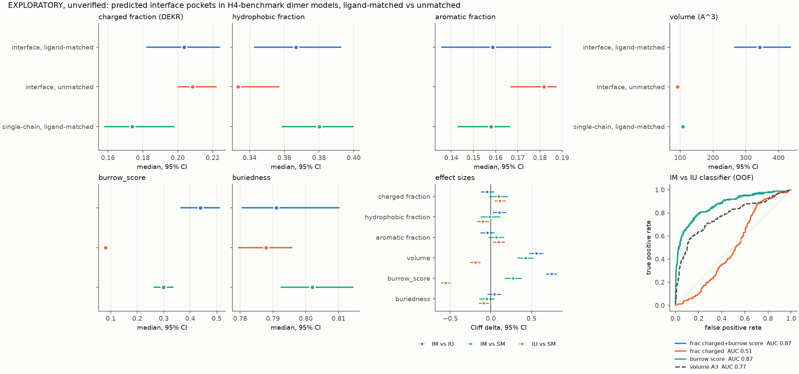

### 4.4 Disease variants (H5; docs/H5_RESULTS.md; reviews/verify_h5.md)

**Data.** 8,279 proteins, 2.58 M non-buried residues, 5,383 P/LP residues.

**[PRE-REG] primary.** Dimer-only pocket vs interface non-pocket: **OR 1.20 (1.07–1.35)**, p = 0.0024, BH family B ≤0.0048 [VERIFIED: 1.19 (1.06–1.34)].

**[PRE-REG secondary] AlphaMissense.** Dimer-only residues score +0.025 above interface non-pocket residues. Against single-chain pocket residues there is no difference (0.700 vs 0.699).

**Not dimer-specific** [VERIFIED]:
- single-chain pocket: 1.17;
- pre-existing interface pocket: 1.25;
- dimer-only vs single-chain pocket: 1.03;
- dimer-only vs pre-existing interface pocket: 0.95.

**Post-hoc composition adjustment and pLDDT** [VERIFIED; the verifier rates the primary FRAGILE]:
- adjusting for amino-acid identity: 1.09 (0.97–1.23);
- pLDDT 70–90: 1.61;
- pLDDT ≥90: 0.99.

**Interpretation.** A modest pocket-lining effect, not a dimer-specific disease signal.

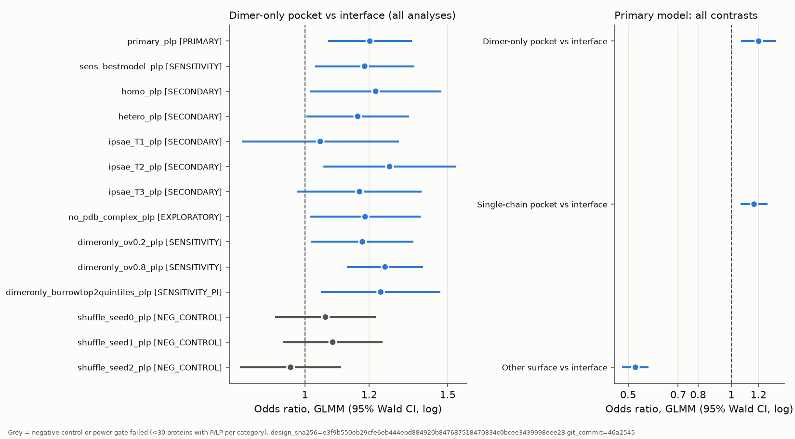

### 4.5 Cross-species conservation (docs/Q24_RESULTS.md) [EXPLORATORY; headline VERIFIED]

- **Method.** Ortholog dimers by reciprocal best hit in 12 species. Pocket conservation decays with divergence: interface pockets 0.84 in mammals → 0.50 in bacteria. Non-ortholog control: 0.01–0.08.
- **Interface vs single-chain.** Interface pockets are conserved slightly more often: +0.030 [0.019, 0.042], score-matched. This holds **in heterodimers only** (+0.047); homodimers give +0.006 (ns).
- **Comparison with Marsh.** Not directly comparable: they measured site conservation in experimental homomers. Our metric requires a confidently predicted ortholog complex.

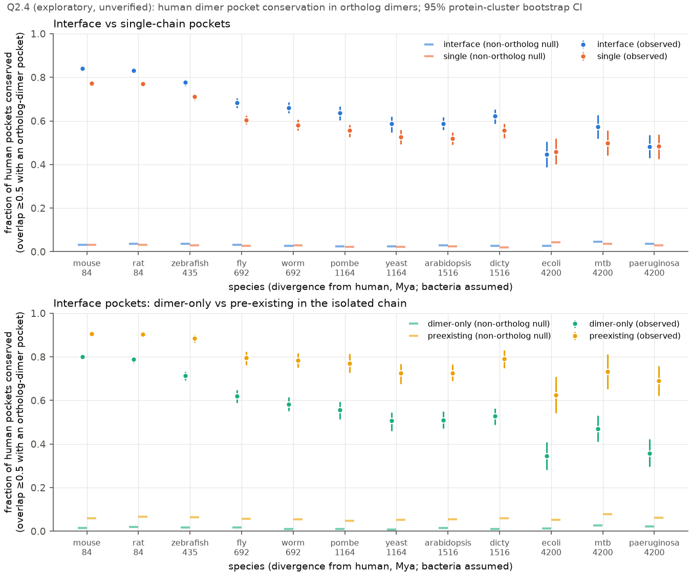

---

## 5. Co-folding re-evaluation (AlphaFold3, no templates) [EXPLORATORY]

Success counts use the verifier's symmetry-aware RMSD (reviews/verify_cofold.md; 109/112 seed-0 calls agree with the producers).

| Batch | Cases | Dimer success | Single-chain success | Release |
|---|---|---|---|---|
| On-axis drug-like (DD1) | 12 | **7/12** | **3/12** | 8 post-, 4 pre-cutoff |
| Off-axis MBS cofactor (control) | 6 | 5/6 | 6/6 | all post-cutoff |
| SBS drug-like (control) | 6 | 3/6 | 2/6 | all post-cutoff |
| Curated dimer-only active sites | 8 | 6/8 | 6/8 | 5 post-cutoff |
| H4 apo-dimer misses (MBS) | 10 | 4/10 | 5/10 | 21/24 entries post-cutoff, but only 3 pairs without an earlier complex |
| H4 apo-dimer hits (MBS) | 8 | 3/8 | 3/8 | ″ |
| H4 heterodimer MBS | 6 | 4/6 | 2/6 | ″ |
| Heterodimer MBS, extended (6 original + 20 new; post-hoc extension) | 26 | 14/26 | 8/26 | 21/26 pairs had a complex before the cutoff; the success gain is pre-cutoff (10/13 vs 5/13; post-cutoff 4/13 vs 3/13) |

**On-axis comparison.**
- Discordant pairs: 4 vs 0 (exact McNemar p = 0.125).
- The single chain gives a worse RMSD in 11/12 cases (sign test p ≈ 0.006).
- Of the four dimer-only successes (PD-L1, caspase-6, MMP12, XIAP), two are pre-cutoff and two are ligand-induced dimers (PD-L1, XIAP).
- AF3 places the ligand on the predicted axis even when the pose is wrong (IDH2, 7.5 Å).

**Cofactor half-sites.**
- Off-axis cofactors (6/6) and FAD in IVD/ACADVL fold correctly as single chains.
- STING1 (n = 1, a 7 + 7 residue split) needs the partner: 0.49 → 5.0 Å.
- Some apo misses are rescued by co-folding (MAT2A 0.48 Å). NAMPT fails both ways; it was run with 1 ligand copy because of GPU memory limits.

**Heterodimer extension** (docs/COFOLD_HETERO_EXT.md; results/cofold/hetero_ext/summary.tsv) [EXPLORATORY; the 21-pair stage was VERIFIED in reviews/verify_v3.md; the final 26-pair numbers were scored with the verifier's RMSD code and re-derived in the final review].
- Complete: 26 pairs.
- Successes: 14/26 (heterodimer) vs 8/26 (single chain). Discordant pairs 7 vs 1, exact McNemar p = 0.070.
- The heterodimer gives a lower RMSD in 22/26 cases (sign test p = 0.0005), often as small gains between two successes.
- No relation to partner share (ρ 0.09, 26 pairs).
- The success gain sits in pairs released before the cutoff (10/13 vs 5/13); after the cutoff it is 4/13 vs 3/13. Memorisation is a plausible contributor.
- The new cases include broader ligand classes than the original six.

**Confidence.** The AF3 ranking score does not separate correct from incorrect poses. Ligand ipTM partly does (0.96 vs 0.72, H4 batch).

**Synthesis across batches** (docs/COFOLD_SYNTHESIS.md, 56 cases; analysis declared before computing; not re-derived by a second agent).
- The RMSD gain from adding the partner rises with the partner share of the site: Spearman ρ 0.34 [0.10, 0.55].
- For success calls the relationship is weaker: ρ 0.17 (ns).
- Per-batch CIs include 0.
- A high partner share appears necessary but not sufficient for a partner benefit.

**Seeds 1–2** (results/cofold/{onaxis,dimeronly}/seeds_summary.tsv) [counts VERIFIED, reviews/verify_v3.md].
- All three seeds are complete for the on-axis and dimer-only experiments. Seed 2 was finished after an overnight Lustre stall by running AF3 from a node-local copy. The seed-2 column was verified at the partial stage; the completed counts were re-derived in the final review.
- Success rates are stable:

| Condition | Seed 0 | Seed 1 | Seed 2 |
|---|---|---|---|
| On-axis dimer | 7/12 | 7/12 | 7/12 |
| On-axis single chain | 3/12 | 3/12 | 2/12 |
| Dimer-only dimer | 6/8 | 6/8 | 6/8 |
| Dimer-only single chain | 5/8 | 5/8 | 5/8 |

- Pooled over 3 seeds: on-axis 21/36 (dimer) vs 8/36 (single chain); dimer-only 18/24 vs 15/24.
- Per-case outcomes agreed across seeds in 10/12 on-axis dimer cases, 11/12 on-axis single-chain cases, and all dimer-only and off-axis cofactor cases.
- STING1 succeeds only as a dimer at every seed.
- Seed 2 on-axis: the single chain is worse in 12/12 cases (discordant pairs 5 vs 0).
- The dimer-only single-chain counts here, including the pooled ones, use the producer metric (5/8). The verifier metric gives 6/8 at seed 0, which is what the batch table above uses.

**Caveats.**
- n = 6–12 per stratum.
- Memorisation is possible, especially for pre-cutoff cases.
- No DockQ.
- Some SBS "dimers" are not biological units.
- AF3 does not flag clashes in 4 H4 failures.

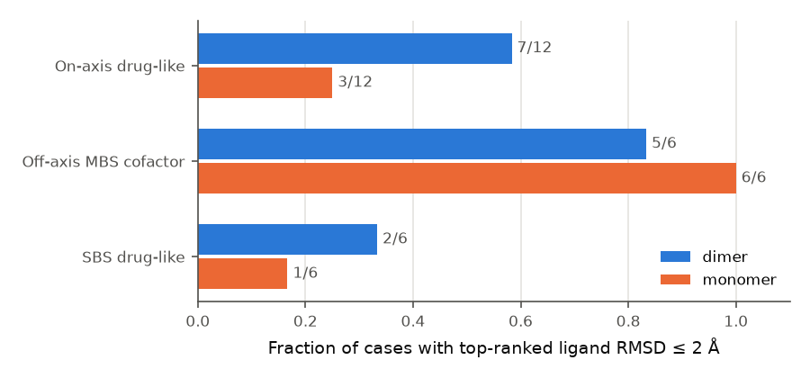
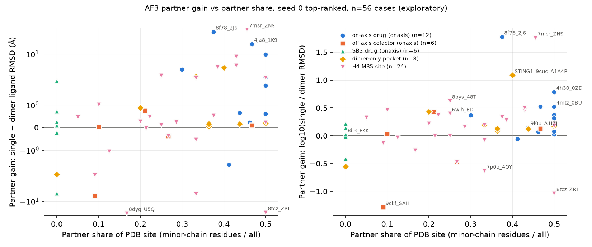

---

## 6. Top-3 differences: deep dives

**Selection rule.** The pre-declared rule (DESIGN §4) was effect size with a CI excluding the null, then interpretability. Strictly, only DD1 (H3) meets the effect-size criterion. DD2 and DD3 were chosen for interpretability and because they answer the prompt's core questions; their primary tests are not significant or are null. This deviates from the rule and is logged.

### DD1: Drug-like ligands dominate sites on the homomer twofold axis

**Finding.** Among homomer multi-chain sites, those where a single ligand sits across the twofold axis are dominated by drug-like ligands (ChEMBL-active compounds, including tool compounds). Cofactors are rare there. Off-axis sites have the opposite mix: 334 drug-like vs 576 cofactor clusters.

**Evidence.**
- H3: cluster-level OR ≈ 14; 64 drug-like vs 8 cofactor on-axis clusters; 23.6 without viral proteins; 5.8 without the top-20 clusters [VERIFIED; descriptive].
- On-axis sites are about 10% of homomer MBS sites.
- Co-folding: the single chain gives a worse RMSD in 11/12 cases. Success 7/12 vs 3/12 is not significant.
- "Needs the partner" is partly true by construction: a single chain carries only half of an on-axis site.

**Examples.**
- HIV-1 protease;
- transthyretin T4 channel (kinetic stabilisers such as tafamidis);
- GluA2 ligand-binding-domain dimer PAMs;
- glutaminase (BPTES class);
- PD-L1 (small molecules that induce the dimer);
- PKM2 activators;
- IDH2 allosteric inhibitors;
- bacterial gyrase NBTIs;
- STING agonists.

**Interpretation (hypothesis).** A twofold axis creates a site that exists only in the oligomer and offers two copies of each contact. That suits compounds that stabilise or induce the oligomer, which is how several of the listed drugs act. Cofactors usually serve one catalytic centre per protomer and occupy two off-axis copies.

This fits the MBS–allostery link of Abrusán & Marsh 2019 and "dual-binding" PPI stabilisers (Chen & Zacharias 2023). The pattern is between proteins, not within proteins, so target-selection and publication bias in drug discovery can contribute.

**What is new** (not found in our literature search of 2026-10-29).
- A class-resolved census of on- vs off-axis homomer sites.
- A co-folding comparison of dimer vs single chain for these sites.

### DD2: Multi-chain sites are found more often in dimer models, but co-folding can often fill them from one chain

**Finding.** Pocket detection on predicted dimers recovers real multi-chain ligand sites more often than isolated chains or monomer models do. The primary test is not significant, but most families agree. Dimer-spanning enzyme active sites appear as dimer-only pockets. In co-folding, the partner mainly improves pose accuracy (RMSD). Its link to how evenly the site is split between chains is suggestive but did not replicate.

**Evidence.**
- H4: MBS hit rate 0.38 vs 0.26 (homo + hetero pooled; homodimers 0.40 vs 0.28); family-weighted DiD 0.158 (0.075–0.234); primary not established [VERIFIED].
- Residue F1 at MBS: 0.371 (dimer) vs 0.311 (isolated) vs 0.296 (monomer atlas).
- Failure modes: isolated chains lose or split the site; dimer models merge pockets; apo tunnels can be too narrow.
- Co-folding: in heterodimers, consistently lower RMSD with the partner (22/26, sign test p 0.0005). The gain in successes is borderline (14/26 vs 8/26, McNemar p 0.07). No success gain in homodimer apo-misses (4/10 vs 5/10) or dimer-only active sites (6/8 vs 6/8). The heterodimer success gain is concentrated in pre-cutoff pairs. The partner-share relationship (ρ 0.34, 56 cases) did not replicate in the heterodimer extension (ρ 0.09).

**Examples.**
- GSTP1·glutathione: dimer hit, isolated-chain miss.
- MAT2A: oversized apo pocket, rescued by co-folding.
- NAMPT: narrow apo tunnel; co-folding fails.
- NQO2: two active sites merged into one pocket.
- STING1: even split; needs the partner.

**What is new** (not found in our search).
- A recovery benchmark of predicted-dimer pockets against PDB multi-chain sites with an isolated-chain control.
- A failure-mode census.
- The detection vs co-folding contrast.
- ProtPocket compares monomer and dimer pockets on homodimers, but we did not find a PDB-site validation.

**Caveats.**
- Post-hoc collapse rule (the verdict flips under the alternative).
- High within-family redundancy.
- Most pairs are pre-AF-cutoff.
- The ACADs are tetramers modelled as dimers.

### DD3: Predicted interface pockets are larger and more charged; real ligand-bound interface sites are only larger

**Finding.**
- In predicted dimers, the partner makes interface pockets larger, more charged and less hydrophobic.
- Real ligand-bound MBS sites are modestly larger but not more charged.
- The abundant cofactors are single-chain-anchored.
- Disease-variant enrichment at pockets is not specific to dimer-only pockets.

**Evidence.**
- Predicted: δ volume +0.23, charged +0.20, hydrophobic −0.15 [VERIFIED].
- PDB (uncropped): δ volume +0.071, charged −0.009, hydrophobic +0.027 [VERIFIED].
- Ligand-matched vs unmatched interface pockets: equally charged.
- H1 strict reversal driven by the major cofactors [VERIFIED].
- H5: pocket-lining effect, composition-dependent [VERIFIED].
- Q2.4: small conservation excess in heterodimers [VERIFIED].

**Interpretation (hypothesis).** The charged character of predicted interface cavities probably reflects the polar complementarity of protein–protein interfaces. Real small-molecule interface sites do not share it. Interface location alone is therefore not evidence of ligandability.

**What is new.**
- Identical descriptors compared side by side in predicted interface pockets and experimental interface ligand sites.
- Cofactor anchoring as the reason a cofactor-vs-drug contrast is null.
- A dimer-specific variant test that came out negative after post-hoc composition adjustment.

**Caveats.**
- The 4 Å contact set.
- Small matched group.
- "Unmatched" does not mean ligand-free.
- humsavar is not ClinVar.

---

## 7. What is new compared with prior work

All absence statements mean "not found in our literature search on 2026-10-29" (LITERATURE.md (h)).

| Topic | Prior work | This study | Status |
|---|---|---|---|
| MBS share | Q-BioLiP 28.8%, PLINDER 25% | 26–31% after additives, by class × assembly; photosynthetic confound | VERIFIED |
| Ligand classes at MBS | Marsh 2018: cofactors > metals | Reproduced; new cofactor-vs-drug-like contrast null; major cofactors single-chain-anchored | PRE-REG, VERIFIED |
| Druggability of MBS | Hypothesised (Marsh); interface cavities often ligandable (Chen & Zacharias 2023) | No difference in fpocket druggability or burrow_score; weak, fragile drug-like occupancy excess | PRE-REG, VERIFIED |
| Twofold-axis sites | Individual examples; dual-binding stabilisers | Drug-like-dominated: 64 drug-like vs 8 cofactor on-axis clusters | PRE-REG (descriptive), VERIFIED |
| Predicted-complex pocket recovery | ProtPocket (monomer vs dimer, homodimers; no PDB validation found) | DiD benchmark with isolated-chain control; family-level gain; failure modes | PRE-REG not established; VERIFIED |
| Interface pocket chemistry | PPI pocket datasets | Predicted charged signature not seen at ligand sites | EXPLORATORY |
| Disease variants | Marsh: high burden at MBS heteromers | Pocket effect, not dimer-specific | PRE-REG, VERIFIED |
| Conservation | Marsh: MBS homomers conserved | Small excess, heterodimers only; not directly comparable | EXPLORATORY, VERIFIED |
| Co-folding at MBS | No MBS-stratified analysis found | Partner ± controls; the partner improves RMSD for on-axis and heterodimer sites; the partner-share link (ρ 0.34) did not replicate in the heterodimer extension (ρ 0.09) | EXPLORATORY |

---

## 8. Limitations and deviations

**Labels.**
- BioLiP2 relevance is noisy (e.g. folate in 1RB2 counts as additive).
- The ChEMBL drug-like label includes tool compounds and misses unmapped inhibitors.

**Redundancy.**
- Inhibitor series inflate unit counts (HIV PR has 127 units).
- Cluster-level results are given where available.

**Predicted structures.**
- Only confident interfaces are included.
- PDB training overlap.
- Apo geometry.
- BURROW context noise (17–20%).
- pocketcompare is weak for PPI pockets.

**Deviations from DESIGN v3** (all logged in RESEARCH_TREE.md):
- Primary set restricted to BioLiP2-covered entries.
- Homomer coverage measured on the longer chain.
- humsavar used for ClinVar; no conservation covariate in H5.
- A 5 Å interface definition.
- H3 per-cell power-gate reading adopted post hoc.
- H4: bootstrap chosen over permutation; collapse rule chosen post hoc.
- Co-folding: templates off; NAMPT run with 1 ligand copy.
- PDB descriptors: the first run was cropped at 30 Å. It was replaced by an uncropped rerun after the verification found the crop mattered; the cropped run is kept as a sensitivity analysis.
- DD2/DD3 selected for interpretability, not by the effect-size rule.
- Symmetric-pocket collapse rules differ between H4 and H5/Q2.2/Q2.4.

**Reproducibility gaps** (DATA.md, docs/SEEDS.md):
- Upstream release dates for the AFDB v6 copy, the PDB mirror and the AF3 weights are not recorded locally; checksums and listing hashes are recorded.
- BioLiP2 redistribution terms are unclear.
- `scripts/make_af3_input.py` defaults to modelSeeds=[1]; the experiment wrappers set the seeds explicitly.
- GPU non-determinism is not controlled by seeds.
- Environment lock files are in envs/.

**Not done.**
- P2Rank.
- kNN ligand-class transfer.
- PLINDER cross-check.

---

## 9. Reproducibility

- **Frozen design.** DESIGN.md v3, tag `design-v3-frozen`; sha256 in results/DESIGN_FROZEN.sha256. The design hash and git commit are in every results TSV.
- **Data.** DATA.md lists source, version, checksum and licence. Downloads are scripted (scripts/fetch_*). data/ is git-ignored and regenerable.
- **Seeds.** [0, 1, 2]; seed 0 is primary.
- **Environment.**
  - `source scripts/env_threads.sh` (thread limit; docs/COMPUTE_POLICY.md).
  - Envs live in .venvs/ and conda_envs/.
  - Use GPUs 1–3 only.
- **Rerun order.** See README.md. Each docs/*.md gives its exact commands. Verification code is in reviews/verify_*/.

---

## 10. Open questions

1. A within-protein test of DD1 (needs a larger census).
2. Druggability: fpocket on the full PDB sample (not only the subsample), P2Rank, and size-matched controls for the dimer-only list.
3. Heterodimers: few MBS sites (119 in H4). In co-folding the partner lowers RMSD consistently (22/26), but success gains are borderline (p 0.07).
4. Holo-like dimer pockets: co-folding or MD to open narrow apo tunnels (NAMPT) and split merged pockets.
5. Harmonise the collapse rules and rerun H4 under one rule.
6. A selection-matched cross-species analysis.
7. Prospective ranking of on-axis pockets in human homodimer models as candidates for oligomer-stabilising compounds.
